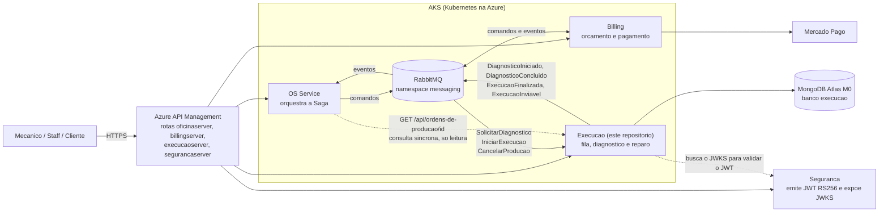
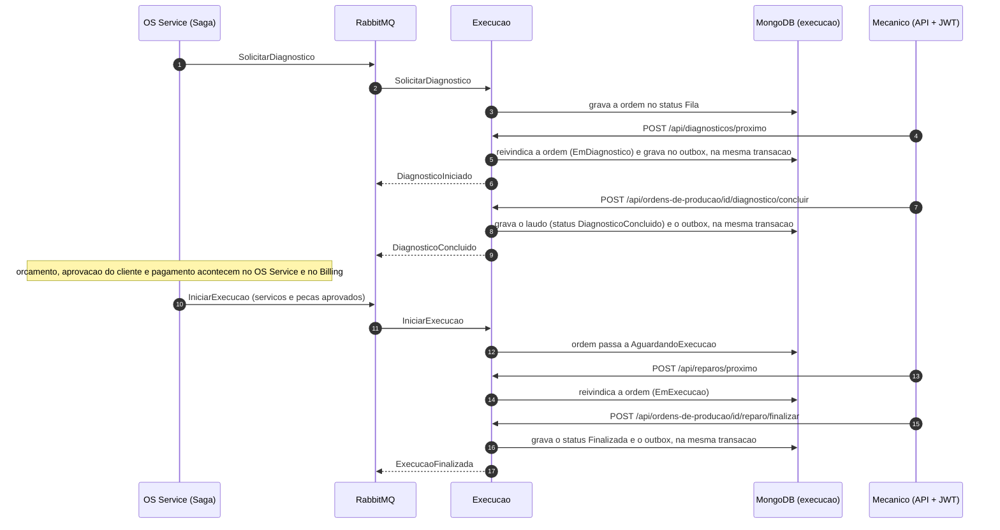
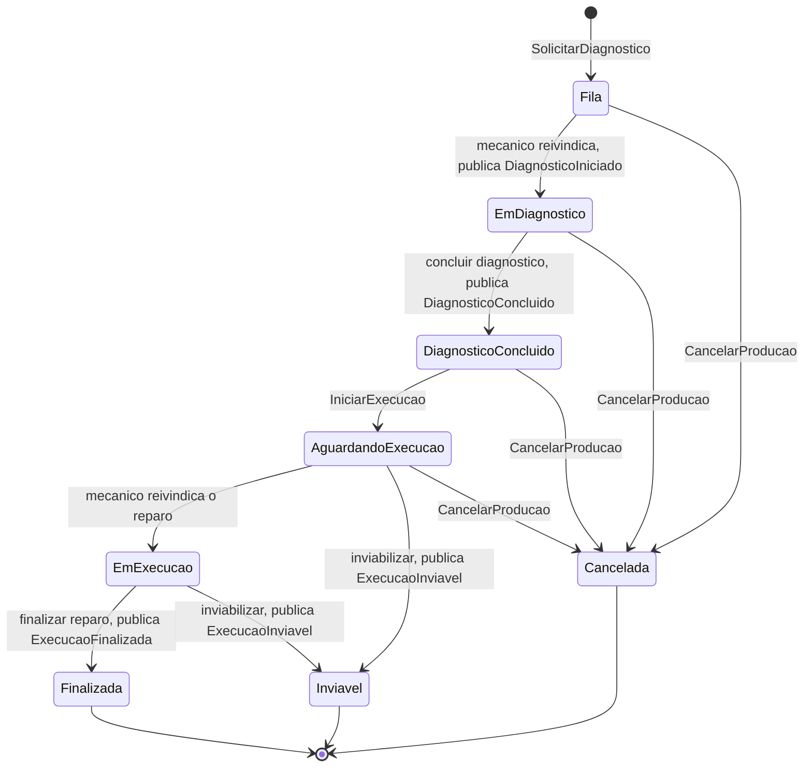

# OficinaMecanica.Execucao

Servico de **fila de execucao, diagnostico e reparo** da oficina mecanica, um dos
tres microsservicos de negocio do ecossistema OficinaMecanica. Ele controla a
producao de cada ordem de servico (OS): a ordem entra numa fila, e diagnosticada
por um mecanico, espera a aprovacao do cliente e o pagamento (tratados por outros
servicos) e, depois, e reparada e finalizada.

E um microsservico .NET 8 com **banco proprio NoSQL (MongoDB Atlas)**. Fala com o
resto do ecossistema **somente por mensagens** (RabbitMQ + MassTransit 8.5.12) e
expoe uma API HTTP para o mecanico operar a fila.

> **Estado da publicacao: nada foi publicado.** O repositorio ainda nao existe no
> GitHub, o workflow de CI nunca rodou no GitHub, nenhuma imagem foi para o
> registry, nenhum deploy foi feito e o servico nunca falou com um cluster
> MongoDB Atlas real. Tudo o que esta descrito aqui como "validado" foi validado
> **localmente** (ver [Estado atual](#estado-atual)). A secao
> [10. Publicacao](#10-publicacao-ainda-nao-executada) lista, em ordem, o que
> falta fazer.

## Sumario

1. [Visao geral](#1-visao-geral)
2. [Arquitetura](#2-arquitetura)
3. [Papel na Saga e justificativa](#3-papel-na-saga-e-justificativa)
4. [API](#4-api)
5. [Como rodar localmente](#5-como-rodar-localmente)
6. [Testes e qualidade](#6-testes-e-qualidade)
7. [CI/CD e Kubernetes](#7-cicd-e-kubernetes)
8. [Decisoes (ADRs)](#8-decisoes-adrs)
9. [Limitacoes conhecidas e pendencias](#9-limitacoes-conhecidas-e-pendencias)
10. [Publicacao (ainda nao executada)](#10-publicacao-ainda-nao-executada)

Os links para `../OficinaMecanica*` apontam para os repositorios irmaos e so
funcionam com todos clonados lado a lado, na mesma pasta pai.

---

## 1. Visao geral

### O que o servico faz

- **Recebe tres comandos** da Saga (ver o termo abaixo) pela fila `execucao-comandos`:
  `SolicitarDiagnostico` (enfileira a ordem), `IniciarExecucao` (libera a ordem
  para o reparo, com o que o cliente aprovou) e `CancelarProducao` (desfaz a
  producao).
- **Publica quatro eventos** de resposta: `DiagnosticoIniciado`,
  `DiagnosticoConcluido`, `ExecucaoFinalizada` e `ExecucaoInviavel`.
- **Expoe uma API HTTP** para o mecanico: pegar a proxima ordem da fila de
  diagnostico ou de reparo, registrar apontamentos, concluir o diagnostico com um
  laudo, finalizar ou inviabilizar o reparo e consultar a fila.
- **Guarda o estado da producao** no MongoDB: um documento por ordem de servico.

Nao tem dependencia de compilacao com nenhum outro repositorio e nenhum servico
acessa o banco de outro.

### Onde se encaixa no ecossistema

| Repositorio | Papel |
|---|---|
| [OficinaMecanica](../OficinaMecanica) (OS Service) | Cadastros, ordens de servico e o **orquestrador da Saga**: decide a sequencia de etapas e manda comandos aos outros servicos |
| [OficinaMecanica.Billing](../OficinaMecanica.Billing) | Orcamento e pagamento (Mercado Pago) |
| **OficinaMecanica.Execucao** (este) | Fila de producao, diagnostico e reparo. **Responde comandos e emite eventos** |
| [OficinaMecanica.Seguranca](../OficinaMecanica.Seguranca) | Emite os JWT (RS256) e expoe o JWKS usado para validar tokens |
| [OficinaMecanica.Infra](../OficinaMecanica.Infra) | Terraform da plataforma (AKS, ACR, Key Vault, APIM, RabbitMQ no AKS, identidades OIDC) |
| [OficinaMecanica.Banco](../OficinaMecanica.Banco) | Terraform dos bancos (Azure SQL e o cluster MongoDB Atlas M0 deste servico) |



O diagrama mostra o desenho de producao. Localmente o mesmo desenho roda com
Docker Compose (ver [secao 5](#5-como-rodar-localmente)): a APIM e o AKS nao
entram, e o RabbitMQ e o do `docker compose` do OS Service.

### Um ciclo de producao, do ponto de vista da Execucao



### Glossario

| Termo | Significado |
|---|---|
| **Saga** | Sequencia de transacoes locais, uma por servico, com **compensacao** (um passo que desfaz o anterior) quando uma etapa falha. Substitui a transacao distribuida, que nao existe entre bancos independentes |
| **Orquestrador** | O coordenador da Saga: manda os comandos e reage aos eventos. Aqui, o OS Service |
| **Outbox / inbox transacional** | Padrao em que a mensagem a publicar e gravada no banco **na mesma transacao** da mudanca de estado (outbox) e um processo a entrega ao broker depois; o inbox registra as mensagens ja processadas para descartar duplicatas |
| **Claim (reivindicar)** | O mecanico "pega" a proxima ordem da fila de forma que nenhum outro pegue a mesma |
| **Tombstone** | Registro de "lapide": marca que algo foi cancelado antes de existir (ver [2.3](#23-modelo-do-documento-ordens_producao)) |
| **Broker / RabbitMQ** | Servidor de mensageria que transporta comandos e eventos entre os servicos |
| **MassTransit** | Biblioteca .NET de mensageria usada sobre o RabbitMQ (consumers, retry, outbox, saga) |
| **Replica set** | Grupo de nos do MongoDB que replicam os mesmos dados; e o pre-requisito das transacoes multi-documento |
| **JWT / RS256 / JWKS** | JWT e o token de acesso; RS256 e a assinatura com par de chaves (privada assina, publica valida); JWKS e o endereco que publica as chaves publicas |
| **APIM** | Azure API Management, o gateway publico na frente dos servicos |
| **AKS / ACR** | Kubernetes gerenciado da Azure / registro de imagens de container da Azure |
| **OIDC (federacao)** | O GitHub Actions obtem credencial temporaria do Azure sem guardar senha de longa duracao |
| **CSI Secrets Store** | Driver do Kubernetes que monta segredos do Azure Key Vault no pod |
| **HPA** | Horizontal Pod Autoscaler: escala o numero de replicas por uso de CPU/memoria |
| **CQRS / DDD** | Separacao entre comandos (escrita) e consultas (leitura) / modelagem do codigo a partir do dominio do negocio |
| **ADR** | Architecture Decision Record: registro curto de uma decisao tecnica e de suas consequencias |
| **`_error`** | Fila onde o MassTransit deposita a mensagem que falhou depois de todas as tentativas (`execucao-comandos_error`) |

### Estado atual

| Validado localmente (sem GitHub e sem Azure) | So existe depois da publicacao |
|---|---|
| Compilacao em Release e 661 testes passando, inclusive os de infraestrutura com MongoDB (replica set) e RabbitMQ reais em containers | Repositorio no GitHub e qualquer execucao real do workflow `CI` |
| Cobertura de linhas de 99,42% (gate de 80%), ver [docs/cobertura.md](docs/cobertura.md) | Analise no SonarCloud e o Quality Gate |
| Imagem Docker construida e executada como usuario nao-root, com sistema de arquivos somente leitura, contra MongoDB e RabbitMQ reais | Scan Trivy no pipeline, imagem no ACR, deploy no AKS |
| `docker compose` completo, `actionlint` e `shellcheck` sem achados, manifests validados com `kubeconform -strict` | Identidade OIDC deste repositorio, rota `execucaoserver` na APIM, ruleset de branch no GitHub |
| Scripts de CI testados (72 casos de falha e 31 mutantes), OpenAPI gerado e conferido, `scripts/ci-local.sh` completo | Cluster MongoDB Atlas M0 (o Terraform do `OficinaMecanica.Banco` nao foi aplicado): **a combinacao transacao + consumer nunca foi testada no Atlas** |

---

## 2. Arquitetura

### 2.1 Camadas e projetos

Clean Architecture (Domain -> Application -> Infrastructure -> API), DDD, CQRS via
MediatR, `ValidationBehavior` (FluentValidation no pipeline do MediatR) e
Repository Pattern (interface no Domain, implementacao na Infrastructure). A
dependencia aponta sempre para dentro: o Domain nao conhece nem o driver do
MongoDB nem o MassTransit.

| Projeto (`src/`) | O que faz |
|---|---|
| `OficinaMecanica.Contracts` | Records das mensagens (comandos, eventos e itens comuns) e as constantes de nome de fila (`Filas`). E uma **copia** do subconjunto usado aqui; nao se edita neste repositorio (ver abaixo) |
| `OficinaMecanica.Execucao.Domain` | Agregado `OrdemDeProducao`, `CancelamentoPrevio` (tombstone), `EtapaProducao`, value objects (`VeiculoDaOrdem`, `ServicoDaOrdem`, `PecaDaOrdem`, `Laudo`, `Apontamento`), enums, excecoes (`DomainException`, `ConcorrenciaException`) e as interfaces de repositorio e de `IUnitOfWork`. Sem dependencias externas |
| `OficinaMecanica.Execucao.Application` | Um caso de uso por pasta: Command ou Query + Handler + Validator. Tambem tem DTOs, o `ValidationBehavior` e a porta `IIntegrationEventPublisher` (como publicar mensagens) |
| `OficinaMecanica.Execucao.Infrastructure` | MongoDB (mapeamento por `BsonClassMap`, repositorios, Unit of Work, transacao, indices criados na partida), MassTransit (consumers finos, publisher, outbox, retry, validacao de configuracao), validacao do JWT por JWKS, health checks e metricas |
| `OficinaMecanica.Execucao.API` | `Program.cs`, controllers finos (so traduzem HTTP para MediatR), middleware de excecoes, Swagger, OpenTelemetry e Serilog |

Os **consumers** de mensagem tambem sao finos: cada um converte o contrato no
command do MediatR e o envia, entao a mesma regra de negocio atende a API e a fila.

Regras do codigo que valem para todo o servico:

- **Publicar antes do commit.** Todo handler publica pela `IIntegrationEventPublisher`
  **antes** do `IUnitOfWork.SaveChangesAsync`; a implementacao grava no outbox na
  mesma transacao do banco. Nunca se publica depois do commit.
- O "agora" nunca vem de `DateTime` dentro do dominio: entra por parametro
  (`DateTimeOffset`), e os handlers leem de `TimeProvider`.
- Idioma: o dominio (entidades, propriedades, mensagens de erro) e em portugues;
  namespaces, camadas e padroes de projeto em ingles.
- **Contratos copiados, nao compartilhados.** Cada servico mantem a sua copia de
  `OficinaMecanica.Contracts` (mesmos namespaces `Commands`, `Events` e `Common`).
  A compatibilidade e travada por testes de contrato com arquivos **golden JSON**
  identicos entre os repositorios; a evolucao so pode ser aditiva. Ver o
  [ADR 0005 do OS Service](../OficinaMecanica/docs/adr/0005-contratos-de-mensagem-por-copia-com-golden-json.md).

Stack: .NET 8, MediatR 12.2.0, FluentValidation 11.9.0, MongoDB.Driver 3.12.0,
MassTransit 8.5.12 (`MassTransit`, `MassTransit.RabbitMQ`, `MassTransit.MongoDb`),
Swashbuckle 6.5.0, Serilog, OpenTelemetry e prometheus-net. Testes: xUnit,
FluentAssertions, Moq, Bogus e Testcontainers (MongoDB e RabbitMQ).

### 2.2 Por que um banco NoSQL (MongoDB Atlas)

Decisao registrada no [ADR 0001](docs/adr/0001-mongodb-atlas-para-a-fila-de-execucao.md).

- **O dado cabe num documento.** Cada ordem e lida e alterada quase sempre
  sozinha (reivindicar, apontar, concluir, finalizar), carrega listas pequenas
  embutidas (servicos, pecas, etapas, apontamentos) e nao tem juncao com dado de
  outro servico. Uma operacao de negocio vira uma leitura e uma escrita.
- **Independencia de banco.** O ecossistema exige banco proprio por servico, e o
  projeto exige pelo menos um banco NoSQL entre os servicos; o Atlas tem camada
  gratuita (M0), compativel com o orcamento.
- **Cluster:** MongoDB Atlas **M0** hospedado no Azure, um replica set de 3 nos
  fixo, provisionado pelo Terraform do repositorio
  [OficinaMecanica.Banco](../OficinaMecanica.Banco) (ver o
  [ADR 0002 do Banco](../OficinaMecanica.Banco/docs/adr/0002-mongodb-atlas-m0-provisionado-por-terraform.md)).
  Localmente e nos testes, um MongoDB 7 em **replica set de 1 no**.
- **Replica set e obrigatorio:** o outbox transacional do `MassTransit.MongoDb`
  usa transacoes, e o MongoDB so as oferece em replica set.
- **Menor privilegio:** o usuario de banco da aplicacao (`execucao_app`) tem
  `readWrite` **somente** no banco `execucao`, nunca `atlasAdmin`; a senha e
  gerada pelo Terraform e so existe no state e no Key Vault. A lista de IPs
  permitidos do Atlas contem apenas o IP de saida do AKS (`/32`), sem
  `0.0.0.0/0`. A connection string e gravada no Key Vault pelo proprio
  repositorio `OficinaMecanica.Banco`.

Alternativas consideradas e descartadas (ADR 0001): Azure SQL como no OS Service e
no Billing (serviria, mas o projeto exige NoSQL e o modelo de documento nao
precisa de tabelas auxiliares); Cosmos DB com API do MongoDB (sem camada gratuita
equivalente e com semantica de transacao propria); ordem e tombstone em colecoes
separadas serializados por lock (mais codigo e falha novos); e a fila como lista
de mensagens no RabbitMQ (a ordem precisa de consulta, listagem, apontamentos e
estado duradouro).

### 2.3 Modelo do documento `ordens_producao`

Uma unica colecao, `ordens_producao` (banco `execucao`), com **um documento por
ordem de servico**. O mapeamento e feito por `BsonClassMap` na Infrastructure
(`MongoMappings`); campos em camelCase, enums como texto, datas como data BSON em
UTC (precisao de milissegundo) e `version` numerico para concorrencia otimista.

| Campo | Conteudo |
|---|---|
| `_id` | **O proprio `OrdemDeServicoId`** (UUID). Uma mensagem repetida da Saga cai sempre no mesmo documento: a chave unica e a idempotencia do enfileiramento |
| `_t` | Discriminador: `ordem` (ver o tombstone abaixo) |
| `version` | Numero de versao do documento; sobe a cada gravacao e protege contra escrita concorrente |
| `numero` | Numero da OS (unico entre as ordens) |
| `veiculo` | `placa`, `marca`, `modelo` |
| `observacoes` | Queixa do cliente, texto livre (opcional) |
| `status` | `Fila`, `EmDiagnostico`, `DiagnosticoConcluido`, `AguardandoExecucao`, `EmExecucao`, `Finalizada`, `Inviavel` ou `Cancelada` |
| `mecanicoId` | Mecanico responsavel (o `sub` do JWT, opaco; opcional) |
| `laudo` | `texto` e `horasEstimadas` (opcional) |
| `resumo` | Resumo do reparo executado (opcional) |
| `motivoInviabilidade`, `inviabilizadaPor`, `motivoCancelamento` | Preenchidos quando a ordem termina em `Inviavel` ou `Cancelada` (opcionais) |
| `enfileiradaEm` | Quando a ordem entrou na fila; ordena a fila de **diagnostico** |
| `liberadaEm` | Quando a ordem ficou `AguardandoExecucao`; ordena a fila de **reparo** |
| `servicos`, `pecas` | Listas embutidas (`servicoId` ou `pecaId`, `nome`, `quantidade`, `precoUnitario`). Na liberacao sao **substituidas** pelo snapshot que o cliente aprovou e pagou |
| `etapas` | Lista de `{nome (Diagnostico ou Reparo), mecanicoId, status (EmAndamento, Concluida, Interrompida), inicio, fim}` |
| `apontamentos` | Lista de `{mecanicoId, texto, em}` |

Exemplo ilustrativo (valores ficticios; campos opcionais ausentes sao omitidos):

```json
{
  "_id": "<OrdemDeServicoId>",
  "_t": "ordem",
  "version": 3,
  "numero": "OS-0001",
  "veiculo": { "placa": "ABC1D23", "marca": "Marca", "modelo": "Modelo" },
  "status": "EmDiagnostico",
  "mecanicoId": "<sub do token>",
  "enfileiradaEm": "2026-01-01T10:00:00Z",
  "servicos": [ { "servicoId": "<uuid>", "nome": "Revisao", "quantidade": 1, "precoUnitario": 100 } ],
  "pecas": [],
  "etapas": [ { "nome": "Diagnostico", "mecanicoId": "<sub do token>", "status": "EmAndamento", "inicio": "2026-01-01T10:05:00Z" } ],
  "apontamentos": []
}
```

**Tombstone de cancelamento previo.** A Saga manda `SolicitarDiagnostico` e,
depois, pode mandar `CancelarProducao` ao mesmo endpoint; como as filas
reordenam e reentregam, o cancelamento pode **chegar antes** de a ordem existir.
Quando isso acontece, a Execucao grava um documento "lapide" na **mesma colecao e
com a mesma chave** (`_id` = `OrdemDeServicoId`), com `_t = cancelamentoPrevio`,
`motivo` e `registradoEm`. O enfileiramento que chegar depois encontra a lapide e
vira no-op: nada e criado nem publicado.

Por que na mesma chave: com documentos em chaves diferentes, a transacao
(isolamento por snapshot) nao impede o *write skew* (duas transacoes leem o mesmo
estado, escrevem em documentos distintos e ambas confirmam) e sobraria uma ordem
orfa na `Fila`. Com a mesma chave as duas escritas colidem, a que perde aborta, e a
nova tentativa ja enxerga o resultado da outra. Um teste de infraestrutura repete
essa corrida e falha se ordem e lapide forem separadas em colecoes diferentes.
Toda leitura de ordem, fila, listagem e contagem filtra `_t = ordem`.

**Indices** (criados na partida pelo `MongoInitializer`, de forma idempotente,
antes de o bus consumir a primeira mensagem):

| Indice | Chaves | Para que serve |
|---|---|---|
| `ix_status_enfileiradaEm` | `status`, `enfileiradaEm` | Fila de diagnostico (FIFO) |
| `ix_status_liberadaEm` | `status`, `liberadaEm` | Fila de reparo (FIFO pela liberacao) |
| `ix_mecanicoId_status` | `mecanicoId`, `status` | Listagem por mecanico |
| `ux_numero` | `numero` (unico, **parcial** so para `_t = ordem`) | Numero da OS unico; a lapide nao tem numero |

Os planos de execucao das consultas do claim usam esses indices, sem ordenacao em
memoria (verificado por `explain` num teste). O mesmo inicializador pre-cria as
colecoes do MassTransit (`inbox.states`, `outbox.messages`, `outbox.states`) e o
indice unico `{MessageId, ConsumerId}` do inbox.

### 2.4 A fila e o claim: dois mecanicos nunca pegam a mesma ordem

Nao ha lock distribuido. O claim usa **concorrencia otimista** sobre o campo
`version`, em quatro passos (`ReivindicacaoDeFila` e `OrdemDeProducaoRepository`):

1. Le a proxima ordem do status (`Fila` para diagnostico, `AguardandoExecucao`
   para reparo) por `enfileiradaEm` ou `liberadaEm` crescente, limite 1. A leitura
   **nao** usa a sessao da transacao, entao sempre enxerga o estado confirmado.
2. Aplica a regra de negocio no agregado em memoria (`IniciarDiagnostico` ou
   `IniciarReparo`): o mecanico vira o responsavel.
3. Grava com `ReplaceOne` filtrando `{_id, _t: "ordem", version: <versao lida>}` e
   gravando `version + 1`. Se o filtro nao casa (outro mecanico gravou antes),
   nenhum documento e alterado e o repositorio lanca `ConcorrenciaException`.
4. Quem perdeu a disputa le a proxima ordem e tenta de novo, **ate 5 vezes**; se a
   disputa nao se resolver, a API responde **409** e o cliente repete a chamada.
   Fila vazia nao e erro: a API responde **204**.

Como so uma gravacao pode casar com uma versao especifica, dois mecanicos nunca
ficam com a mesma ordem. Nota: o claim nao usa `FindOneAndUpdate`; a transicao de
estado continua sendo regra do agregado (passo 2) e a atomicidade vem do filtro
por versao no passo 3. Os testes de infraestrutura exercitam o caso com 6
mecanicos disputando 24 ordens em MongoDB real (nenhuma ordem repetida, FIFO por
mecanico, um evento por claim).

O claim de **diagnostico** publica `DiagnosticoIniciado`, entao a gravacao entra
na **mesma transacao** do outbox. O claim de **reparo** nao publica nada e roda
sem transacao: a Saga ja considera a OS em execucao desde o pagamento aprovado, e
so o fim do reparo (finalizado ou inviavel) interessa a ela.

### 2.5 Mensageria: RabbitMQ, MassTransit 8.5.12 e outbox no MongoDB

**Transporte e versao.** RabbitMQ via MassTransit, com `MassTransit`,
`MassTransit.RabbitMQ` e `MassTransit.MongoDb` **fixos em 8.5.12** (versao exata,
sem curinga). Motivo: a partir da versao 9 o MassTransit exige **licenca
comercial**; a linha 8 continua gratuita, mas sem suporte oficial apos 31/12/2026
(ver o [ADR 0004 do OS Service](../OficinaMecanica/docs/adr/0004-masstransit-8-gratuito-e-fim-de-suporte.md)).
Guardrails: o CI falha se qualquer pacote `MassTransit*`, direto ou transitivo,
resolver para um major diferente de 8 (`scripts/verificar-masstransit.sh`) e o
Dependabot ignora o major do `MassTransit*` e do `MongoDB.Driver*` (que fica na
versao que o `MassTransit.MongoDb 8.5.12` traz, 3.12.0).

**Endpoint.** Um unico endpoint de recepcao, `execucao-comandos`
(`Filas.Execucao`), com os tres consumers. O `MessageId` do contrato e copiado
para o `MessageId` do envelope: e por ele que o inbox deduplica.

**Outbox e inbox transacionais no MongoDB** (`AddMongoDbOutbox`, `UseBusOutbox` no
caminho HTTP e `UseMongoDbOutbox` no endpoint). A mudanca de estado da ordem e a
mensagem para a Saga confirmam **juntas ou nenhuma delas**: nunca ordem alterada
sem evento, nem evento sem ordem alterada. As condicoes sem as quais essa
combinacao falha, medidas no spike que antecedeu o servico e registradas no
[ADR 0002](docs/adr/0002-outbox-mongodb-do-masstransit-e-unit-of-work.md):

| Condicao | Como o servico a atende |
|---|---|
| Transacoes exigem **replica set** | Compose e testes usam replica set de 1 no; o Atlas M0 e um replica set de 3 nos (**nao verificado no Atlas real**) |
| **Publicar antes do commit** | Regra da Application (`IIntegrationEventPublisher`); publicar depois perderia a mensagem se o processo caisse entre os dois passos |
| **Retry por fora do filtro do outbox** | `UseMessageRetry` no endpoint, com intervalos exponenciais: uma falha transitoria do proprio outbox (inbox, abertura ou commit da transacao) e retentada em vez de ir para `_error`. No spike, 18 a 20 de 40 duplicatas concorrentes caiam em `_error` sem isso |
| **Colecoes e indice do inbox criados antes do bus** | `MongoInitializer` registrado antes do MassTransit: criar colecao ou indice (DDL) dentro de uma transacao colide com a primeira mensagem |
| **`WaitUntilStarted = true`** | A API so fica pronta depois de o bus subir; o custo esta nas [limitacoes](#9-limitacoes-conhecidas-e-pendencias) |
| Mensagens chegam **pelo menos uma vez** (podem duplicar, ate em paralelo) | Inbox com janela de deduplicacao de 30 min e, como segunda defesa, idempotencia natural do dominio (ver [2.8](#28-idempotencia-e-compensacoes)) |
| O retry **reexecuta o handler inteiro** | Os handlers sao idempotentes e sem efeito colateral antes do commit |

**Unit of Work com commit explicito.** O MongoDB nao tem "SaveChanges", e publicar
sem confirmar perderia o evento em silencio. No caminho HTTP, o `TransacaoBehavior`
(pipeline do MediatR) abre a transacao e o `MongoUnitOfWork.SaveChangesAsync` a
confirma; so os quatro commands que publicam evento entram (`ReivindicarProximoDiagnostico`,
`ConcluirDiagnostico`, `FinalizarReparo`, `InviabilizarExecucao`), e um teste confere
essa lista contra os handlers que dependem do publisher. Em caso de
`TransientTransactionError`, o behavior reexecuta o handler **inteiro** (ate 8
vezes, com espera crescente e aleatoria); esgotadas as tentativas, vira 409. Dentro
de um consumer a transacao e a do outbox do MassTransit, que a confirma; o UoW nao
confirma de novo.

**Retry e fila de erro.** Excecao de negocio ou de validacao nao melhora com nova
tentativa e vai direto para `execucao-comandos_error`; as demais (inclusive
`KeyNotFoundException` e `ConcorrenciaException`) sao retentadas (padrao: 5
tentativas, de 200 ms a 30 s). Esgotadas, a mensagem vai para `_error` e o MassTransit
publica um `Fault<T>`, que a Saga trata (ver [secao 3](#3-papel-na-saga-e-justificativa)).

**Configuracao segura.** Os pontos de troca para teste, `Mensageria__Transporte`
(`RabbitMq` ou `EmMemoria`) e `Mensageria__Outbox` (`MongoDb` ou `Nenhum`), so valem
em `Development` e `Testing`; a partida em outro ambiente com transporte em memoria
ou sem outbox e recusada (`ValidateOnStart`). Um numero fora do enum falha em
qualquer ambiente, em vez de cair para "memoria sem outbox".

#### Comandos consumidos

Todos chegam em `execucao-comandos`. Nenhum comando publica evento de resposta.

| Comando | Command interno | Efeito | Reentrega e erros |
|---|---|---|---|
| `SolicitarDiagnostico` (numero, placa, marca, modelo, observacoes, servicos, pecas) | `EnfileirarOrdemDeProducao` | Cria a ordem em `Fila`. Nao exige servico: o diagnostico ainda define o que fazer | Ordem ja existente: ignora. Lapide existente (cancelado antes): ignora, nada e publicado. Colisao concorrente de `_id`: descarta quem perde |
| `IniciarExecucao` (numero, servicos e pecas **aprovados**) | `LiberarParaExecucao` | `DiagnosticoConcluido` -> `AguardandoExecucao`; **substitui** servicos e pecas pelo snapshot aprovado e grava `liberadaEm`. Exige ao menos um servico | Ordem ja liberada, em execucao, finalizada ou inviavel: no-op. Antes de o diagnostico concluir ou `Cancelada`: `DomainException` (vai para `_error`). Ordem inexistente: `KeyNotFoundException` (retentada pelo backoff) |
| `CancelarProducao` (motivo) | `CancelarProducao` | Em `Fila`, `EmDiagnostico`, `DiagnosticoConcluido` ou `AguardandoExecucao`: ordem -> `Cancelada`. Ordem inexistente: grava a **lapide** | Ja `Cancelada`: no-op. Em `EmExecucao`, `Finalizada` ou `Inviavel`: `DomainException` (vai direto para `_error`, sem retry; a Saga recebe o `Fault`) |

#### Eventos publicados

Todos saem pelo outbox, na mesma transacao da mudanca de estado. Todo contrato
carrega `MessageId`, `OrdemDeServicoId` e `OcorridoEm`.

| Evento | Quando | Dados | Efeito na Saga (OS Service) |
|---|---|---|---|
| `DiagnosticoIniciado` | Um mecanico reivindica a ordem em `POST /api/diagnosticos/proximo` (**nao** ao enfileirar) | `MecanicoId` | `AguardandoDiagnostico` -> `EmDiagnostico` |
| `DiagnosticoConcluido` | `POST /api/ordens-de-producao/{id}/diagnostico/concluir` | `MecanicoId`, `Laudo` | `EmDiagnostico` -> `GerandoOrcamento`; a Saga manda `GerarOrcamento` ao Billing |
| `ExecucaoFinalizada` | `POST /api/ordens-de-producao/{id}/reparo/finalizar` | `Resumo`, `FinalizadaEm` | `EmExecucao` -> `Concluida` (OS finalizada) |
| `ExecucaoInviavel` | `POST /api/ordens-de-producao/{id}/reparo/inviabilizar` | `Motivo` | `EmExecucao` -> `Estornando`; a Saga manda `EstornarPagamento` ao Billing e, depois do estorno, cancela a OS e libera o estoque |

Registrar apontamento e reivindicar o reparo nao publicam nada. Nenhuma mensagem
leva CPF, e-mail ou telefone: so a placa do veiculo, que a Execucao precisa para
identificar a ordem.

### 2.6 Ciclo de vida da ordem de producao



Regras que o agregado `OrdemDeProducao` garante (violacao vira `DomainException`,
HTTP 400 na API, ou `_error` no consumer):

- Cada acao so vale a partir de certos status; fora deles e erro de negocio.
- **Responsavel.** Apontamento, conclusao do diagnostico e finalizacao do reparo
  so valem para o mecanico responsavel (`mecanicoId` e um id opaco, comparado sem
  normalizar caixa). Quem inicia o reparo vira o responsavel.
- **Inviabilizar** vale em `AguardandoExecucao` e em `EmExecucao`. Em `EmExecucao`
  so o mecanico responsavel pode; em `AguardandoExecucao` ninguem assumiu o reparo,
  entao qualquer mecanico identificado pode. Quem inviabilizou fica sempre em
  `inviabilizadaPor`.
- **Cancelar** nao vale a partir de `EmExecucao`: uma producao em reparo so se
  desfaz por `ExecucaoInviavel`.
- Textos livres (laudo, resumo, motivos, observacoes, apontamento) sao gravados e
  publicados ja sem espacos nas pontas.
- A liberacao para execucao substitui servicos e pecas pelo snapshot aprovado: o
  que o cliente aprovou e pagou pode diferir do que foi enfileirado.

### 2.7 Observabilidade

Logs com Serilog; traces e metricas por OpenTelemetry (OTLP) **somente** quando
`Otel__Endpoint` esta configurado; `/metrics` em formato Prometheus. O servico tem
um `Meter` proprio (`OficinaMecanica.Execucao`) com:

- **Contadores:** `ordens_enfileiradas_total`, `diagnosticos_concluidos_total`,
  `reparos_finalizados_total`, `ordens_inviabilizadas_total`,
  `cancelamentos_previos_total` (no HTTP so contam depois do commit).
- **Medidores (gauges)** atualizados a cada 15 s: `fila_ordens{status}`,
  `fila_idade_mais_antiga_segundos{status}` (base para alerta de prazo de
  diagnostico e reparo; **so metrica**, nada e cancelado) e
  `outbox_mensagens_pendentes` (mensagens ainda nao entregues ao broker, o alerta
  de broker fora, ja que a prontidao nao o cobre).

As metricas HTTP do prometheus-net (`http_requests_received_total`,
`http_request_duration_seconds`) leem o status final da resposta: o
`UseHttpMetrics()` fica **antes** do middleware de excecoes, entao o 499 do cliente
que abandonou e os erros mapeados (400, 404, 409, 500) saem com o `code` real. Um
teste de pipeline (`MetricasHttpTests`) trava essa ordem.

Dashboard e alertas no New Relic **ainda nao foram criados** (ver pendencias).

### 2.8 Idempotencia e compensacoes

| Situacao | Como e tratada |
|---|---|
| Mesma mensagem entregue mais de uma vez, ate em paralelo | Inbox deduplica por `MessageId` (janela de 30 min); alem disso `_id` = `OrdemDeServicoId` torna o enfileiramento idempotente, e `Cancelar` e `LiberarParaExecucao` devolvem "nada a fazer" na reentrega. Teste: o handler executa uma vez |
| Falha depois de gravar e publicar | O outbox e atomico: 0 documentos alterados e 0 mensagens. Teste de infraestrutura com falha injetada |
| Cancelar antes de criar | Lapide (tombstone) na mesma chave; o enfileiramento tardio vira no-op. Corrida `Enfileirar` x `CancelarProducao` testada em varias rodadas |
| Dois mecanicos na mesma ordem | Filtro por `version` no claim (ver [2.4](#24-a-fila-e-o-claim-dois-mecanicos-nunca-pegam-a-mesma-ordem)) |
| Conflito de transacao no HTTP | Reexecucao do handler (ate 8x); esgotado, 409 |
| Comando que nunca vai dar certo (erro de negocio) | Sem retry, vai para `execucao-comandos_error`; a Saga recebe o `Fault` e registra erro estruturado (reenvio e manual, por redrive) |
| Broker fora do ar | O outbox guarda as mensagens no banco e o servico continua aceitando escrita; o alerta e a metrica `outbox_mensagens_pendentes` |
| Producao que nao pode ser feita | A Execucao publica `ExecucaoInviavel`; **quem compensa** (estorno do pagamento, liberacao do estoque) e a Saga |

A Execucao **nao orquestra compensacoes**: ela so garante que o proprio passo e
idempotente, atomico com o evento que publica, e reversivel quando a Saga pede
(`CancelarProducao` antes do reparo, `ExecucaoInviavel` depois dele).

---

## 3. Papel na Saga e justificativa

### Por que Saga orquestrada (e nao coreografada)

Resumo do [ADR 0003 do OS Service](../OficinaMecanica/docs/adr/0003-saga-orquestrada-no-os-service.md)
e do [RFC 0005](../OficinaMecanica/docs/rfc/0005-decomposicao-em-microsservicos-com-saga-orquestrada.md).

**O problema.** Abrir uma OS, gerar o orcamento, esperar a aprovacao, cobrar e
executar atravessa tres servicos com bancos independentes. Nao ha transacao
distribuida (o commit em duas fases, 2PC, nao existe no Azure SQL serverless nem no
MongoDB Atlas, e acoplaria a disponibilidade dos tres servicos). A consistencia vem
de uma **Saga**: transacoes locais em sequencia, com compensacao quando uma etapa
falha.

**As duas formas.** Na **orquestrada**, um coordenador central comanda cada etapa;
na **coreografada**, cada servico reage a eventos dos outros, sem coordenador.

| Criterio | Orquestrada (escolhida) | Coreografada |
|---|---|---|
| Onde esta o fluxo | Num unico lugar, legivel: uma maquina de estados no OS Service | Espalhado em tres repositorios |
| Rastreabilidade | O estado da Saga mostra exatamente onde cada OS parou | A compensacao e dificil de rastrear |
| Testabilidade | Cenarios BDD cobrem o fluxo feliz e as compensacoes sem subir os tres servicos | Exige teste de ponta a ponta |
| Acrescentar uma etapa | Altera o orquestrador | Altera varios servicos |
| Acoplamento | O OS Service concentra o conhecimento do processo | Servicos mais desacoplados |
| Volume de mensagens e estados | Maior | Menor |

Para um fluxo **linear, com compensacoes bem definidas**, o custo de
rastreabilidade da coreografia pesa mais que o ganho de desacoplamento.

**O custo assumido.** O OS Service passa a concentrar o conhecimento do processo
(acoplamento de orquestracao) e vira ponto sensivel de disponibilidade para o
fluxo. A mitigacao e o outbox transacional: nada se perde, so atrasa. Ha mais
mensagens e estados do que numa coreografia minima, e exige disciplina de
idempotencia em todo comando e consumer (ver [2.8](#28-idempotencia-e-compensacoes)).
Um orquestrador como servico separado foi descartado: criaria um quarto servico a
operar no no unico do AKS, sem ganho, ja que o OS Service e dono do agregado que a
Saga conduz.

### A Execucao e propositalmente simples

O ADR 0003 registra como consequencia positiva que os servicos de apoio ficam
simples: **recebem um comando, respondem com um evento, sem conhecer o fluxo
completo.** E exatamente o desenho da Execucao:

- Ela conhece **tres comandos** e **quatro eventos**, nada mais. Nao sabe o que e
  orcamento, pagamento, estoque, prazo ou estorno.
- Nao decide quando uma OS comeca, espera ou termina: reage ao que a Saga manda e
  responde o que aconteceu na producao.
- Falha de negocio vira **evento explicito** (`ExecucaoInviavel`); `Fault<T>` e
  reservado a falha tecnica.
- Nao tem timer de prazo: o timeout de diagnostico e de reparo so gera alerta na
  Saga (um reparo em andamento nao se desfaz por relogio). Aqui existem apenas as
  metricas de idade da fila.

### O que a Saga faz com a Execucao

Extraido da [maquina de estados da Saga](../OficinaMecanica/docs/saga-maquina-de-estados.puml):

| Momento na Saga | Mensagem | Reacao da Execucao |
|---|---|---|
| OS aberta | Saga -> `SolicitarDiagnostico` | Enfileira a ordem |
| Mecanico reivindica o diagnostico | `DiagnosticoIniciado` -> Saga | `AguardandoDiagnostico` -> `EmDiagnostico` |
| Mecanico conclui o diagnostico | `DiagnosticoConcluido` -> Saga | Saga gera o orcamento |
| Pagamento aprovado | Saga -> `IniciarExecucao` | Libera a ordem com o snapshot aprovado |
| Reparo finalizado | `ExecucaoFinalizada` -> Saga | `EmExecucao` -> `Concluida` |
| Reparo impossivel | `ExecucaoInviavel` -> Saga | Saga estorna o pagamento e cancela |
| Cancelamento pelo staff (antes da execucao) | Saga -> `CancelarProducao` | Cancela a ordem ou grava a lapide |
| Falha tecnica de `IniciarExecucao` | `Fault<IniciarExecucao>` | A Saga estorna o pagamento |
| Falha tecnica de `CancelarProducao` | `Fault<CancelarProducao>` | So log de erro na Saga: sem reenvio automatico nem transicao; o comando espera em `_error` para redrive manual (ADR 0008 do OS Service) |

Tambem existe uma **consulta sincrona**, somente leitura: o OS Service chama
`GET /api/ordens-de-producao/{id}` repassando o JWT do chamador, com timeout, retry
e circuit breaker, e cai no ultimo estado conhecido da Saga se a Execucao estiver
indisponivel (ver o [ADR 0006 do OS Service](../OficinaMecanica/docs/adr/0006-quebras-de-api-e-comunicacao-sincrona-x-assincrona.md)).
A regra pratica: escrita entre servicos e sempre assincrona; leitura entre servicos
pode ser sincrona so se tiver degradacao definida. Documento completo da Saga:
[docs/saga-maquina-de-estados.puml](../OficinaMecanica/docs/saga-maquina-de-estados.puml).

---

## 4. API

Contrato versionado em [docs/openapi.json](docs/openapi.json) (OpenAPI gerado da
API compilada; o CI falha se estiver desatualizado, ver
[secao 7](#7-cicd-e-kubernetes)).

### Autenticacao e autorizacao

- A Execucao **so valida** tokens; nao emite. Valida o JWT assinado com **RS256**
  emitido pelo `OficinaMecanica.Seguranca`, buscando a chave publica no **JWKS**
  (`JwtSettings__JwksUri`), sem segredo compartilhado. Confere assinatura,
  emissor (`OficinaMecanica.Seguranca`), audiencia (`OficinaMecanica.Client`) e
  validade. Se o `kid` do token nao esta no cache do JWKS, a chave e rebuscada
  antes de recusar (rotacao de chave).
- **Todos os endpoints de negocio sao `[Authorize]` simples**: qualquer token
  valido serve. **Nao ha papel distinto** para "mecanico" ou "supervisor": o
  Seguranca emite hoje so o perfil `Admin`, entao restringir por papel exige
  evoluir o Seguranca primeiro.
- O mecanico e **sempre** o claim `sub` do token. Campo de corpo com o id do
  mecanico nao existe (e seria ignorado): ninguem apropria uma ordem em nome de
  outro. Sem `sub`, a resposta e 401.
- **Anonimos:** `GET /health`, `GET /health/ready`, `GET /metrics` e o Swagger.

### Rotas

| Metodo e rota | Autorizacao | Respostas | Descricao |
|---|---|---|---|
| `POST /api/diagnosticos/proximo` | JWT | 200 ordem, 204 fila vazia, 401, 409 | Reivindica a proxima ordem da fila de diagnostico; publica `DiagnosticoIniciado` |
| `POST /api/reparos/proximo` | JWT | 200, 204, 401, 409 | Reivindica a proxima ordem liberada para reparo (FIFO pela liberacao) |
| `POST /api/ordens-de-producao/{id}/apontamentos` | JWT | 200, 400, 401, 404, 409 | Registra um apontamento (corpo: `texto`); so o mecanico responsavel, em diagnostico ou execucao |
| `POST /api/ordens-de-producao/{id}/diagnostico/concluir` | JWT | 200, 400, 401, 404, 409 | Conclui o diagnostico (corpo: `laudo`, `horasEstimadas` opcional); publica `DiagnosticoConcluido` |
| `POST /api/ordens-de-producao/{id}/reparo/finalizar` | JWT | 200, 400, 401, 404, 409 | Finaliza o reparo (corpo: `resumo`); publica `ExecucaoFinalizada` |
| `POST /api/ordens-de-producao/{id}/reparo/inviabilizar` | JWT | 200, 400, 401, 404, 409 | Marca a execucao como inviavel (corpo: `motivo`); publica `ExecucaoInviavel` |
| `GET /api/ordens-de-producao/{id}` | JWT | 200, 401, 404 | Consulta uma ordem (usada pela consulta sincrona do OS Service); 404 tambem quando so existe a lapide |
| `GET /api/fila?status=&mecanicoId=&pagina=&tamanho=` | JWT | 200, 400, 401 | Lista paginada (`pagina` a partir de 1, `tamanho` de 1 a 100, padrao 1 e 10) |
| `GET /api/fila/resumo` | JWT | 200, 401 | Quantidade de ordens por status (todos os status, mesmo com zero) |
| `GET /health` | anonimo | 200 | Liveness: o processo esta de pe (sem dependencias) |
| `GET /health/ready` | anonimo | 200 ou 503 | Prontidao: MongoDB fora = 503; broker fora = 200 com `Degraded` |
| `GET /metrics` | anonimo | 200 | Metricas no formato Prometheus |

Erros saem sempre no mesmo formato (`ErrorResponse`: `tipo`, `mensagem` e, em
validacao, `erros[]` com `campo` e `mensagem`): regra de negocio ou validacao
-> 400; ordem inexistente -> 404; conflito de versao ou de transacao esgotado -> 409;
sem `sub` -> 401; cliente que abandonou a requisicao -> 499 sem corpo (abaixo);
qualquer outra falha -> 500 sem detalhes internos.

### Cliente que abandona a requisicao (499)

Quando o chamador (o proprio mecanico, a APIM ou um proxy) fecha a conexao antes da
resposta, o `RequestAborted` dispara e o `ExceptionHandlingMiddleware` responde **499 sem
corpo** (convencao do nginx para "cliente fechou a requisicao"): nao ha mais para quem
responder e, por isso, nao conta como erro do servidor. O log e **Information** e leva so
o **template da rota** (por exemplo `api/ordens-de-producao/{id}`, ou
`(rota desconhecida)`) e o trace id; nunca o caminho real, a query nem o token. E
seguranca por construcao: nas rotas da Execucao o caminho so leva o GUID da ordem, mas o
log nao depende disso. Cancelamento com o cliente ainda conectado (timeout interno de
uma dependencia) continua 500 com log de erro. Com a resposta ja iniciada o middleware
nao mexe mais em status nem em cabecalhos (o Kestrel nao deixa): registra o erro e
aborta a conexao (o cliente ve a falha em vez de uma resposta truncada que parece
completa). Se foi o proprio cliente que fechou a conexao, ela ja esta fechada e so
sai um log Information. O `/metrics` conta a chamada como `code="499"` (e os erros
mapeados com o `code` real).

**O que acontece com um claim abandonado** (medido contra MongoDB e RabbitMQ reais):

- **Diagnostico** (`POST /api/diagnosticos/proximo`, com a transacao do outbox): o
  cancelamento antes do commit aborta a transacao (a ordem continua em `Fila`, o outbox
  tem 0 mensagens e nenhum evento sai). Com o commit ja enviado ao servidor ele pode
  completar ("resultado desconhecido"): a ordem vai para `EmDiagnostico` com o mecanico
  e sai exatamente 1 `DiagnosticoIniciado`; so a resposta se perde. Sem estado parcial
  em 210 iteracoes.
- **Reparo** (`POST /api/reparos/proximo`, sem transacao, um unico `ReplaceOne`): a
  escrita pode ser aplicada sem o mecanico receber a resposta (139 de 150 e 56 de 60
  nos abandonos medidos).

Para saber se o claim valeu, o cliente consulta a fila do proprio mecanico:
`GET /api/fila?status=EmDiagnostico&mecanicoId=<sub do token>` (diagnostico) ou
`GET /api/fila?status=EmExecucao&mecanicoId=<sub do token>` (reparo). **Limitacao
conhecida:** repetir o `POST` as cegas reivindica **outra** ordem, e a primeira fica
parada com o mecanico (nao ha timer de reparo que a devolva a fila). A recomendacao ao
cliente e consultar a fila antes de repetir a chamada.

### Swagger UI

O Swagger UI esta na **raiz** do servico (`RoutePrefix` vazio). Localmente, com o
compose no ar: `http://localhost:5002/` (o JSON em `/swagger/v1/swagger.json`).
Para chamar um endpoint protegido, clique em **Authorize** e informe
`Bearer <token>` (o esquema e um cabecalho `Authorization`). Atras da APIM, o
`servers[]` do documento e calculado por requisicao a partir do cabecalho
`X-Forwarded-Prefix`, entao o "Try it out" aponta para o prefixo publico
(`/execucaoserver`).

---

## 5. Como rodar localmente

### Pre-requisitos

- Docker Desktop (com `docker compose`).
- .NET 8 SDK e `bash` (no Windows, Git Bash) para compilar, testar e rodar os
  scripts de `scripts/`.
- Para o ecossistema completo: o `docker compose` do OS Service (dono do RabbitMQ
  compartilhado) e o do Seguranca (emite o JWT e publica o JWKS).

### Subindo

```bash
cp .env.example .env     # preencha RABBITMQ_USER e RABBITMQ_PASS
docker compose up -d --build
curl http://localhost:5002/health
```

O `docker-compose.yml` e **autocontido** para o que e deste servico: sobe a `api`
(build local, porta 5002 -> 8080) e o `mongo` (`mongo:7.0.45` como **replica set de
1 no**; o healthcheck inicia o `rs.initiate` e so fica saudavel quando o no vira
PRIMARY, que e o que a API precisa para abrir transacoes; volume nomeado). Containers
`oficinamecanica-execucao-*` (prefixo trocavel por `EXECUCAO_PREFIXO`).

| Servico | Porta no host | Observacao |
|---|---|---|
| API | `5002` (`EXECUCAO_API_PORT`) | Swagger em `/`, health em `/health` e `/health/ready` |
| MongoDB | `127.0.0.1:27018` (`EXECUCAO_MONGO_PORT`) | So local: sem autenticacao. Em ferramentas do host use `directConnection=true` |
| RabbitMQ (so com `--profile standalone`) | `127.0.0.1:5673` e `15673` | Painel de gerenciamento em `http://localhost:15673` |

### De onde vem o RabbitMQ

O dono do broker compartilhado e o compose do **OS Service** (portas `5672` e
`15672`). Duas opcoes:

1. **Com o ecossistema local** (padrao): suba antes o compose do OS Service. A API
   da Execucao o alcanca por `host.docker.internal:5672` (`RABBITMQ_HOST` e
   `RABBITMQ_PORT` do `.env`). `RABBITMQ_USER` e `RABBITMQ_PASS` devem ser as mesmas
   credenciais que o OS Service usa (`RABBITMQ_DEFAULT_USER` e
   `RABBITMQ_DEFAULT_PASS` no `.env` dele). Nao ha credencial padrao no codigo.
2. **Isolada**: `docker compose --profile standalone up -d --build` sobe um RabbitMQ
   (`rabbitmq:4.4.0-management`) neste compose; no `.env` use `RABBITMQ_HOST=rabbitmq`
   e `RABBITMQ_PORT=5672`, e escolha as credenciais.

Se `host.docker.internal` resolver para um IPv6 inalcancavel no Docker Desktop, use o
IP do host em `JWKS_URI` e `RABBITMQ_HOST`. No Git Bash do Windows, `docker run -v`
precisa de `MSYS_NO_PATHCONV=1` para nao converter o caminho do volume.

Para parar e apagar os dados locais: `docker compose --profile standalone down -v`.

### Variaveis de configuracao

Formato `Secao__Chave`. No compose, as de uso comum vem do `.env` (ver
`.env.example`); o resto tem padrao no `appsettings.json`.

| Chave | Uso |
|---|---|
| `ConnectionStrings__MongoDb` | **Obrigatoria.** Replica set (`?replicaSet=rs0` no compose). No Atlas, segredo vindo do Key Vault |
| `MongoDb__Database` | Nome do banco (padrao `execucao`) |
| `JwtSettings__Issuer`, `Audience`, `JwksUri` | Validacao do JWT do Seguranca. No compose, `JWKS_URI` (padrao `http://host.docker.internal:7071/.well-known/jwks.json`) |
| `RabbitMq__Host`, `Port`, `VirtualHost`, `Username`, `Password` | Broker (sem credencial padrao no codigo) |
| `Mensageria__Transporte`, `Mensageria__Outbox` | `RabbitMq` ou `EmMemoria`; `MongoDb` ou `Nenhum` (so `Development` e `Testing` aceitam trocar) |
| `Mensageria__Retentativas`, `IntervaloInicialEmMs`, `IntervaloMaximoEmMs` | Retry do consumer (padroes 5, 200, 30000) |
| `Mensageria__IntervaloDoOutboxEmMs`, `JanelaDeDeduplicacaoEmMinutos` | Polling do outbox (1000) e deduplicacao (30) |
| `Metricas__IntervaloDeAtualizacaoEmSegundos` | Medidores da fila (15) |
| `Health__ProntidaoCacheSegundos` | Cache do resultado de `/health/ready` (5; 0 desliga, so para testes) |
| `Otel__Endpoint` | Endpoint OTLP; vazio desliga traces e metricas por OTLP |

**Nunca** coloque connection string do Atlas ou credencial do RabbitMQ em arquivo
versionado: o `.env` e ignorado pelo Git e so o `.env.example` (com placeholders) e
versionado.

### Saude

- `GET /health` -> sempre 200 se o processo esta de pe. E o **liveness**: nao toca em
  banco nem broker, porque queda de dependencia nao pode reiniciar o pod.
- `GET /health/ready` -> **readiness**, com corpo JSON (`status` e
  `checks.<nome>.status`). MongoDB fora: **503** (tira o pod da rotacao). RabbitMQ fora:
  **200 com `Degraded`**, porque, com o outbox, o servico continua aceitando escrita
  (a mensagem espera no banco); derrubar a rotacao por causa do broker viraria
  indisponibilidade total em cascata. O alerta do broker fica por metrica
  (`outbox_mensagens_pendentes`). O resultado e guardado em cache de 5 s, porque o
  endpoint e anonimo e qualquer cliente que o alcance dispararia uma conexao AMQP e
  um ping no banco por requisicao.

### Obtendo um token

Com o Seguranca local no ar (porta 7071), `POST http://localhost:7071/login` com
`{"cpf":"...","senha":"..."}` devolve o `token`. O usuario administrador inicial e o
definido pelo proprio Seguranca no `.env` dele (`SEED_ADMIN_CPF` e
`SEED_ADMIN_SENHA`); ver o [README do Seguranca](../OficinaMecanica.Seguranca/README.md).

---

## 6. Testes e qualidade

### Projetos de teste

| Projeto (`tests/`) | Conteudo | Testes |
|---|---|---|
| `OficinaMecanica.Contracts.Tests` | Contratos de mensagem com **golden JSON** (bytes identicos aos do repositorio de origem) | 23 |
| `OficinaMecanica.Execucao.Domain.Tests` | Regras do agregado e dos value objects, **sem mocks** | 185 |
| `OficinaMecanica.Execucao.Application.Tests` | Handlers e validators com Moq, um arquivo por caso de uso | 162 |
| `OficinaMecanica.Execucao.Integration.Tests` | 238 sem Docker (mapeamento BSON, consumers, publisher, behavior, API completa via `WebApplicationFactory` com fakes) e 53 `[Trait("Category","Infra")]` com Testcontainers | 291 |
| `OficinaMecanica.Execucao.Tests.Common` | Builders Bogus (`OrdemDeProducaoBuilder` etc.) e `RelogioFixo` | (apoio) |

Total: **661 testes** (medicao de 2026-11-08). Convencoes: FluentAssertions (sem
`Assert.*` puro); Moq no Application.Tests e, no Integration.Tests, onde um fake em
memoria nao serve (consumers, health checks, middleware e metricas HTTP); testes que
aguardam uma tarefa que o codigo pode deixar de liberar usam `.ComTetoAsync(...)` (teto de
6 s), para falhar com mensagem clara em vez de travar a execucao.

### Como rodar

```bash
dotnet build -c Release
dotnet test --filter "Category!=Infra"   # sem Docker
dotnet test --filter "Category=Infra"    # Testcontainers; precisa de Docker
dotnet test                              # tudo

bash scripts/ci-local.sh                 # os mesmos passos do job "Build & Test" do CI (--sem-infra se nao ha Docker)
bash scripts/cobertura.sh                # cobertura mesclada com gate de 80%
```

### Testes de infraestrutura (Testcontainers)

Rodam contra **MongoDB 7.0.45 em replica set e RabbitMQ 4.4.0 reais**, sem mocks do
banco nem do broker. Cobrem:

- fluxo de producao ponta a ponta, com um OS Service simulado;
- **outbox atomico:** falha depois de gravar e publicar => 0 documentos alterados e 0
  eventos;
- **mensagem duplicada** (mesmo `MessageId`, inclusive copias concorrentes)
  processada uma vez;
- **claim concorrente:** 6 mecanicos x 24 ordens, nunca a mesma ordem, FIFO por
  mecanico, um evento por claim; fila de reparo ordenada por `liberadaEm`;
- **corrida `Enfileirar` x `CancelarProducao`** (varias rodadas, com encontro forcado
  dos dois handlers e sem; nunca sobra ordem na `Fila`);
- liberacao para execucao idempotente;
- retry de `TransientTransactionError` (conflito de escrita provocado de verdade;
  reexecucao e esgotamento -> 409) e retry **por fora** do filtro do outbox;
- indices (inclusive `explain` sem ordenacao em memoria), metricas e prontidao (o
  RabbitMQ e parado e a API segue com 200 `Degraded`; o MongoDB e parado e a API
  responde 503 com o `/health` em 200).

Nao ha paralelismo entre classes de teste (o `Meter` e estatico e os containers sao
compartilhados).

### BDD: por que nao ha cenarios Gherkin aqui

A **Saga tem BDD no OS Service** (Reqnroll + xUnit, Gherkin em portugues, com Billing
e Execucao programaveis): la o que se descreve e o processo de negocio que atravessa
os servicos, com seus caminhos felizes e compensacoes. A Execucao nao tem processo
proprio para narrar: ela recebe um comando e responde um evento. Os cenarios que
importam aqui sao de **consumer, concorrencia, atomicidade e idempotencia** (mensagem
duplicada, disputa pela fila, falha no meio do commit, cancelamento antes da criacao),
que so provam algo contra MongoDB e RabbitMQ reais. Por isso vivem como testes de
integracao e de consumer (`Integration.Tests`, em especial a pasta `Infra`), com nomes
que dizem o cenario, e nao como `.feature`.

### Gate de cobertura e SonarCloud

- **Gate:** cobertura de linhas >= **80%** do servico inteiro (Contracts, Domain,
  Application, Infrastructure e API), unindo **todos** os projetos de teste,
  inclusive os de infraestrutura. Vale para o numero "com exclusoes"
  (`scripts/verificar-cobertura.sh`), calculado dos contadores inteiros
  (`Covered lines` / `Coverable lines`), nao do percentual arredondado: 79,96%
  nao pode passar como 80%.
- **Ultima medicao** (2026-11-08, `bash scripts/cobertura.sh`): **99,42%** com exclusoes
  (1718 de 1728 linhas) e 99,42% bruto (1899 de 1910). Detalhes, exclusoes e como regenerar:
  [docs/cobertura.md](docs/cobertura.md).
- **SonarCloud** com Quality Gate bloqueante no job `Quality`, usando a mesma lista de
  exclusoes de cobertura. **Ainda nao rodou**: depende da publicacao.
- **Os proprios gates sao testados** (`scripts/testar-scripts.sh`): 72 casos de falha
  com entradas sinteticas e 31 mutantes (defeitos plantados em copias dos scripts,
  cada um precisa ser detectado), inclusive a prova de que o gate esta ligado ao
  relatorio.
- `[ExcludeFromCodeCoverage]` e proibido sem um ADR; o `cobertura.sh` lista as
  ocorrencias em `src/` (hoje nenhuma).

---

## 7. CI/CD e Kubernetes

Pipeline proprio e independente dos outros servicos em
[.github/workflows/ci.yml](.github/workflows/ci.yml) (nome `CI`). Roda em `push` e
`pull_request` para `main` e `release` e sob demanda (`workflow_dispatch`). Decisoes
no [ADR 0003](docs/adr/0003-ci-cd-independente-com-gate-de-qualidade.md).
**O workflow nunca rodou no GitHub**: foi validado com `actionlint` e pelos scripts
que ele chama, que tambem rodam na maquina do desenvolvedor (`scripts/ci-local.sh`).

### Os cinco jobs

| Job | Quando roda | O que garante |
|---|---|---|
| **Build & Test** (check obrigatorio) | Sempre | O codigo compila em Release; os scripts de CI detectam as falhas que deveriam detectar; nenhum pacote `MassTransit*` esta fora do major 8; os manifests do Kubernetes sao validos (`kubeconform -strict`); `docs/openapi.json` esta em dia com a API; todos os testes passam, inclusive os de infraestrutura com MongoDB e RabbitMQ reais; cobertura mesclada >= 80%. Publica resultados dos testes, resumo de cobertura e artefatos (`openapi.json`, `relatorio-de-cobertura`, `resultados-dos-testes`, `cobertura-opencover`) |
| **Quality** (check obrigatorio) | Depois do anterior; pulado em PR de fork | Analise no SonarCloud com Quality Gate bloqueante. Sem `SONAR_TOKEN` ou variaveis, falha com mensagem clara em vez de passar sem analisar |
| **Scan Image (Trivy)** | So `push` ou `workflow_dispatch` em `main`/`release`, depois dos dois anteriores | Constroi a imagem **sem enviar**, escaneia com o Trivy (reprova vulnerabilidade `HIGH`/`CRITICAL` que ja tenha correcao) e guarda a imagem aprovada como artefato. So tem permissao `contents: read` |
| **Build & Push Docker Image** | Mesma condicao, depois do scan | Autentica no Azure por OIDC, carrega a **mesma** imagem escaneada (sem reconstruir) e a envia ao ACR com a tag do commit (`:latest` so a partir da `main`) |
| **Deploy to AKS** | Mesma condicao, depois do push | OIDC, renderiza os manifests com a imagem do commit, `kubectl apply`, `set image` e `rollout status` (limite de 420 s). Um deploy por vez (`concurrency`), sem cancelar o que esta rodando |

**Sem migration.** O MongoDB nao tem esquema: os indices e as colecoes do
outbox/inbox sao criados de forma idempotente pelo `MongoInitializer` na partida de
cada pod, antes de o bus consumir. O deploy e so imagem, e nenhuma credencial de
banco passa pelo runner do GitHub.

### Separacao de privilegios

- **Nenhum segredo do Azure.** O login e por **OIDC**: a identidade do repositorio so
  aceita `push` em `main` e `release` (nao ha credencial para `pull_request`), entao
  `Build & Test` e `Quality` em PR nunca tocam o Azure. Roles: `AcrPush` e `AKS
  Cluster Admin`; nenhuma role no Key Vault (o pipeline nao le segredo: a connection
  string do Atlas e as credenciais do RabbitMQ chegam ao pod pelo CSI).
- **OIDC so no job de push e de deploy.** As actions de terceiros (`docker/*`,
  `aquasecurity/trivy-action`) ficam no `Scan Image`, que so le o repositorio (sem
  `id-token`). O job de push, que tem `id-token: write`, so executa `actions/*`,
  `azure/login` e comandos `docker`. `scripts/verificar-workflow.sh` guarda essa regra
  (e e testado). Os checkouts usam `persist-credentials: false`.
- O unico segredo de longa duracao e o `SONAR_TOKEN` (o SonarCloud nao suporta OIDC).
- PR nunca publica imagem.

### Protecao de branch (ruleset versionado)

[.github/rulesets/protect-main-release.json](.github/rulesets/protect-main-release.json)
protege `main` e `release`: sem exclusao nem force-push, PR obrigatorio e os checks
`Build & Test` e `Quality` obrigatorios (os mesmos nomes em todos os repositorios do
ecossistema). `bash scripts/aplicar-ruleset.sh [owner/repo] [--dry-run]` cria ou
atualiza o ruleset via `gh api`; **so roda na publicacao**. Ha tambem um
[template de PR](.github/PULL_REQUEST_TEMPLATE.md) e o
[Dependabot](.github/dependabot.yml) semanal (NuGet, GitHub Actions e Docker; ignora
o major do `MassTransit*`, do `MongoDB.Driver*` e das imagens base do .NET).

### Dockerfile

Build em varias etapas: o `restore` fica numa camada propria (so os `.csproj` entram
antes), entao a camada de pacotes so e refeita quando uma dependencia muda. A imagem
final e `mcr.microsoft.com/dotnet/aspnet:8.0`, roda como **usuario nao-root**
(`USER $APP_UID`), escuta na porta 8080 e define `OTEL_EXPORTER_OTLP_METRICS_TEMPORALITY_PREFERENCE=delta`
(a New Relic zera contadores recebidos como cumulativos).

### Manifests (`k8s/execucao/`)

| Arquivo | O que define |
|---|---|
| `deployment.yaml` | Namespace `default`. Sem `replicas` (o HPA manda). `runAsNonRoot` (uid 1654), `readOnlyRootFilesystem` com `emptyDir` em `/tmp`, `capabilities: drop ALL`, `seccompProfile: RuntimeDefault`, sem token de service account. Requests `50m`/`192Mi`, limits `300m`/`384Mi`. `maxSurge: 0` e `maxUnavailable: 1`. `ASPNETCORE_ENVIRONMENT=Production` (o validador recusa transporte em memoria ou sem outbox fora de `Development` e `Testing`). Segredos por `secretKeyRef` do Secret `execucao-secrets`. Um unico placeholder, `${IMAGE}`, que o CI renderiza |
| **Probes** (no `deployment.yaml`) | `startupProbe` em `/health` de ate 5 min (60 x 5 s); `livenessProbe` em `/health`; `readinessProbe` em `/health/ready` (`timeoutSeconds: 5`, periodo de 30 s). Racional completo no ADR 0003 |
| `hpa.yaml` | De 1 a 2 replicas, alvo de 70% de CPU e 80% de memoria sobre o *request*. O teto de 2 e seguro porque o claim usa `version` e o inbox deduplica |
| `service.yaml` | `ClusterIP`, porta 80 -> 8080; nada expoe o pod direto na internet |
| `ingress.yaml` | Prefixo `/execucao(/\|$)(.*)` (expressao regular) no `ingress-nginx` com `rewrite-target: /$2`; o OS Service segue como catch-all em `/`. O `X-Forwarded-Prefix` vem da policy da APIM |
| `secret-provider-class.yaml` | **Key Vault CSI:** monta do Key Vault `kvfiap` tres segredos (`execucao-mongo-connection-string`, `rabbitmq-username`, `rabbitmq-password`) e os sincroniza no Secret `execucao-secrets` |

---

## 8. Decisoes (ADRs)

Neste repositorio:

| ADR | Decisao |
|---|---|
| [0001](docs/adr/0001-mongodb-atlas-para-a-fila-de-execucao.md) | MongoDB Atlas, um documento por ordem; claim por versao sem lock; indices; tombstone na mesma chave |
| [0002](docs/adr/0002-outbox-mongodb-do-masstransit-e-unit-of-work.md) | Outbox/inbox do MassTransit no MongoDB, publicar antes do commit, retry por fora do outbox, Unit of Work com commit explicito, prontidao com broker `Degraded` |
| [0003](docs/adr/0003-ci-cd-independente-com-gate-de-qualidade.md) | CI/CD independente de cinco jobs, gate de cobertura de 80%, scan antes do push em job sem OIDC, OpenAPI versionado, ruleset |

Em outros repositorios do ecossistema (leitura complementar):

| Documento | Assunto |
|---|---|
| [RFC 0005 do OS Service](../OficinaMecanica/docs/rfc/0005-decomposicao-em-microsservicos-com-saga-orquestrada.md) | Decomposicao em tres microsservicos com Saga orquestrada |
| [ADR 0003 do OS Service](../OficinaMecanica/docs/adr/0003-saga-orquestrada-no-os-service.md) | Por que Saga orquestrada hospedada no OS Service |
| [ADR 0004 do OS Service](../OficinaMecanica/docs/adr/0004-masstransit-8-gratuito-e-fim-de-suporte.md) | MassTransit 8.x gratuito, versao fixada, fim de suporte da linha 8 |
| [ADR 0005 do OS Service](../OficinaMecanica/docs/adr/0005-contratos-de-mensagem-por-copia-com-golden-json.md) | Contratos de mensagem copiados por servico e travados por golden JSON |
| [ADR 0006 do OS Service](../OficinaMecanica/docs/adr/0006-quebras-de-api-e-comunicacao-sincrona-x-assincrona.md) | Quando usar comunicacao sincrona e assincrona; consulta sincrona a Execucao |
| [ADR 0002 do Banco](../OficinaMecanica.Banco/docs/adr/0002-mongodb-atlas-m0-provisionado-por-terraform.md) | Cluster Atlas M0, usuario e secret provisionados por Terraform |
| [ADR 0004 do Infra](../OficinaMecanica.Infra/docs/adr/0004-rabbitmq-no-aks-statefulset-com-imagem-oficial.md) | RabbitMQ no AKS como StatefulSet com imagem oficial |
| [ADR 0006 do Infra](../OficinaMecanica.Infra/docs/adr/0006-modulo-oidc-parametrizado-por-servico-e-criacao-condicional.md) | Modulo OIDC por servico, criado so quando o repositorio existe |
| [ADR 0007 do Infra](../OficinaMecanica.Infra/docs/adr/0007-bloqueio-de-health-ready-e-metrics-na-apim.md) | Bloqueio de `/health/ready` e `/metrics` na rota publica da APIM |

---

## 9. Limitacoes conhecidas e pendencias

**Bloqueante antes do primeiro push real**

- **Fixar as actions de terceiros por SHA.** Hoje `docker/*`, `aquasecurity/trivy-action`,
  `dorny/test-reporter`, `azure/login` e `azure/aks-set-context` estao por **tag de
  versao**, que e mutavel. Antes da publicacao devem ser trocadas pelo SHA **completo**
  de commit de uma versao verificada (com a tag em comentario) e o ADR 0003 atualizado;
  conferir antes as versoes de `aquasecurity/trivy-action` e `dorny/test-reporter`.

**Nunca verificado em ambiente real**

- **Transacao + consumer no Atlas M0.** A pagina oficial de limites do Atlas e
  silenciosa sobre transacoes multi-documento no M0; ele e um replica set de 3 nos,
  entao e esperado que funcione, mas so foi testado em MongoDB 7 local. Se o M0 recusar ou estrangular transacoes, o plano B
  e o do ADR 0001: outbox embutido no documento mais um relay proprio (mais codigo e
  entrega duplicada sem *lease*).
- **Cluster Atlas M0 e regiao.** O Terraform do `OficinaMecanica.Banco` nunca foi
  aplicado; nem toda regiao Azure oferece o M0 (padrao `US_EAST_2`, a confirmar).
- **Decisao pendente no Banco: como o CI alcanca a API do Atlas.** A Administration API
  do Atlas exige, por padrao, uma access list de IPs na API key, e o runner do GitHub
  tem IP variavel. As opcoes (`0.0.0.0/0` na access list da propria API key, desligar o
  requisito na organizacao ou runner proprio com IP fixo) estao no
  [README do Banco](../OficinaMecanica.Banco/README.md#decisao-pendente-como-o-ci-alcanca-a-api-do-atlas) e no ADR 0002 de la.
  Ate decidir, `plan` e `apply` pelo CI do Banco recebem 403, o job `validate` trava e,
  como o `apply` depende dele, o provisionamento do cluster que a Execucao usa fica
  bloqueado pelo CI. A decisao e os secrets do Atlas precisam estar prontos antes do
  merge do Banco em `release`.
- **Primeira execucao do workflow, Quality Gate, Trivy, deploy e OIDC:** so validados
  por ferramentas locais.
- **Rota da APIM.** A premissa de que a APIM concatena o path do backend (`/execucao`)
  com o path da operacao nao pode ser provada sem aplicar o Terraform; se falhar, o
  plano alternativo e reescrever a URL na policy.
- O **ruleset** replica o dos outros repositorios, mas nao foi possivel comparar com o
  GitHub: confirmar na publicacao.

**Limites do Atlas M0 (plano gratuito)**

- 512 MB (documentos e indices), 500 conexoes e cerca de 100 operacoes por segundo (o
  Atlas estrangula, nao rejeita); pausa apos 30 dias sem conexoes; o cluster nao e
  modificavel (trocar nome ou regiao recria e **apaga os dados**, por isso o
  `prevent_destroy`).
- O outbox do MassTransit custa cerca de 37 operacoes de banco por mensagem (medido no
  spike), o que limita o teto a poucas mensagens por segundo; o intervalo de leitura
  (`Mensageria__IntervaloDoOutboxEmMs`, padrao 1 s) e configuravel.
- **Backup:** nenhuma rotina de backup ou restauracao esta configurada neste repositorio
  nem no Terraform do Banco, e o plano gratuito nao deve oferecer backup gerenciado (a
  confirmar na documentacao do Atlas, pois nada foi aplicado). Tratar os dados como
  descartaveis ate haver uma estrategia.
- A allowlist do Atlas aceita so o IP de saida do AKS (`/32`): se o cluster for
  recriado e o IP mudar, os pods perdem acesso ao MongoDB ate atualizar
  `aks_egress_ip` no Banco.

**Seguranca e exposicao**

- **`/health/ready` e `/metrics` sao anonimos e a rota `execucaoserver` da APIM repassa
  qualquer path.** O custo de `/health/ready` ja esta limitado pelo cache de 5 s (no
  maximo uma conexao AMQP e um ping no Atlas por janela), mas o cache nao esconde o
  endpoint nem o `/metrics`. **No repositorio `OficinaMecanica.Infra`** a policy da APIM
  que devolve 404 para esses dois paths na rota publica ja existe e fica ativa quando o
  Terraform do Infra for aplicado (ainda nao foi); as probes do kubelet e a coleta de
  metricas nao passam pela APIM.
- **Sem papeis na API.** Qualquer token valido opera a fila e pode inviabilizar uma
  ordem em `AguardandoExecucao`. Diferenciar mecanico e supervisor depende de o
  Seguranca emitir outros perfis.
- O check `Quality` **pulado** em PR de fork conta como satisfeito para o GitHub: PR de
  fork nao passa pelo Sonar e depende de revisao.
- `main` e `release` fazem deploy no **mesmo** Deployment e no mesmo banco: a
  homologacao e so de processo (branch protegida e PR obrigatorio), nao de
  infraestrutura isolada.

**Capacidade e operacao do cluster**

- **Orcamento do no.** O cluster tem um unico no e os *requests* de CPU quase chegam ao
  total. Por isso o `maxSurge: 0` (com uma replica ha uma janela sem pod a cada deploy;
  os comandos da Saga esperam no RabbitMQ e so a API do mecanico fica fora do ar) e o
  teto de 2 replicas no HPA. **Antes do primeiro deploy**, conferir a folga de CPU com
  `kubectl describe node`.
- **Broker fora na partida.** Com `WaitUntilStarted = true`, a API nao abre a porta
  enquanto o RabbitMQ estiver inalcancavel, sem limite de tempo (medido, sem crash). A
  `startupProbe` finita de 5 min mata o pod, que entra em `CrashLoopBackOff` ate o
  broker voltar, e nenhum pod **novo** sobe durante uma queda do broker. Risco aceito:
  os pods que ja estao de pe seguem atendendo por causa do outbox.
- Readiness de 30 s: ate 90 s para tirar um pod da rotacao.
- **Indices criados pela API na partida:** uma mudanca incompativel com um indice
  existente (mesmo nome, outras chaves) derruba a partida do pod novo e exige um passo
  manual no Atlas; indice novo e idempotente.
- Dashboard e alertas (New Relic) dos medidores da fila e do outbox **ainda nao foram
  criados**.

**Limites de modelagem**

- **Lapides nao expiram:** ha uma por cancelamento previo. Se o volume crescer, um
  indice TTL em `registradoEm` (com filtro parcial por `_t`) resolve sem mudar o
  contrato.
- Data BSON tem precisao de milissegundo: ordens com `enfileiradaEm` ou `liberadaEm`
  empatados no mesmo milissegundo ficam em ordem arbitraria entre si.
- `UnknownTransactionCommitResult` (commit com resultado desconhecido) nao e tratado a
  parte: a falha sobe e e retentada como qualquer outra, protegida pela idempotencia.
- **Claim abandonado:** se o cliente larga a conexao, o claim pode ter valido sem ele
  receber a resposta. Repetir o `POST` as cegas pega outra ordem e deixa a primeira
  parada; ver "Cliente que abandona a requisicao (499)" em Rotas.
- No consumer, se o commit do outbox falhar, a mensagem e reprocessada e a **metrica**
  conta de novo (metrica operacional, nao contabil).
- A Execucao nao consulta dado de outro servico: so conhece o que a Saga envia.
- **MassTransit 8:** a linha 8 fica sem suporte oficial apos 31/12/2026. A rota de
  saida documentada e migrar a Infrastructure de mensageria (Rebus ou um fork) sem
  tocar em Domain e Application.

---

## 10. Publicacao (ainda nao executada)

> **Nada abaixo foi executado.** Esta secao e o roteiro. Publicar exige autorizacao
> explicita e credenciais proprias (MongoDB Atlas, SonarCloud, GitHub e Azure).

### Pre-requisitos

| Item | Detalhe |
|---|---|
| Conta e organizacao no **MongoDB Atlas** + **API key** de organizacao | O cluster M0, o usuario `execucao_app` e o segredo no Key Vault sao **provisionados pelo Terraform do repositorio `OficinaMecanica.Banco`**; este repositorio so consome o segredo. Ver o [README do Banco](../OficinaMecanica.Banco/README.md) e o [ADR 0002](../OficinaMecanica.Banco/docs/adr/0002-mongodb-atlas-m0-provisionado-por-terraform.md). **Decisao pendente** de como o CI do Banco acessa a API key (ver o passo 2) |
| **Conta Azure** com os recursos do `OficinaMecanica.Infra` aplicados | AKS (`aksfiap`), ACR (`acrfiap`), Key Vault (`kvfiap`), APIM, RabbitMQ no AKS (namespace `messaging`) e os segredos `rabbitmq-username` e `rabbitmq-password`. Ordem entre repositorios: **Banco -> Infra -> deploy dos servicos** (ver o [README do Infra](../OficinaMecanica.Infra/README.md#microsservicos-billing-execucao-e-rabbitmq)) |
| **SonarCloud** | Organizacao e projeto criados; variaveis do repositorio `SONAR_PROJECT_KEY` e `SONAR_ORGANIZATION`; secret `SONAR_TOKEN` (tambem em Settings > Secrets > **Dependabot**, senao os PRs do Dependabot reprovam em `Quality`) |
| **OIDC (Azure)** | Variaveis do repositorio `AZURE_CLIENT_ID`, `AZURE_TENANT_ID` e `AZURE_SUBSCRIPTION_ID` |
| GitHub CLI (`gh`) autenticada | Com permissao de administracao no repositorio (para o ruleset) |

### Passos, na ordem

Todos **ainda nao executados**.

1. [ ] **Fixar as actions de terceiros por SHA completo** em
   `.github/workflows/ci.yml` e registrar no ADR 0003 (item bloqueante da
   [secao 9](#9-limitacoes-conhecidas-e-pendencias)).
2. [ ] **Garantir os recursos de dados e de plataforma**, na ordem: aplicar o
   `OficinaMecanica.Banco` (cluster Atlas, usuario, `aks_egress_ip` na allowlist e o
   secret `execucao-mongo-connection-string` no Key Vault; o primeiro apply e **local**,
   com um administrador humano, e o CI do Banco so funciona depois do bootstrap) e,
   depois, o `OficinaMecanica.Infra` (RabbitMQ, rota `execucaoserver`, segredos).

   **Decisao pendente do Banco, a tomar antes do merge dele em `release`:** o CI do
   Banco precisa alcancar a Administration API do Atlas, que exige, por padrao, uma
   access list de IPs na API key, e o runner hospedado do GitHub tem IP variavel.
   Opcoes (secao [Decisao pendente: como o CI alcanca a API do Atlas](../OficinaMecanica.Banco/README.md#decisao-pendente-como-o-ci-alcanca-a-api-do-atlas)
   do README do Banco e ADR 0002 de la): (a) `0.0.0.0/0` na access list da **propria API
   key** (nao do cluster, que continua restrito ao `/32` do AKS); (b) desligar o
   requisito de access list na organizacao do Atlas; (c) listar as faixas do GitHub
   (inviavel: sao muitas e mudam toda semana); (d) runner proprio com IP fixo. Sem a
   decisao, `plan` e `apply` pelo CI do Banco recebem 403 do Atlas, o job `validate`
   trava e, como o `apply` depende dele, o provisionamento do cluster que a Execucao
   usa fica bloqueado pelo CI. O primeiro apply (local) nao depende do runner, mas
   exige o IP da maquina do administrador na access list da API key.
3. [ ] **Criar o repositorio** `willianrmattos/OficinaMecanica.Execucao` no GitHub
   (nome que o `ci.yml`, o ruleset e o Terraform esperam), vazio e **sem empurrar nada
   ainda**.
4. [ ] **Preencher o ID do repositorio no `OficinaMecanica.Infra` e aplicar o
   Terraform.** Obter o ID com
   `gh api repos/willianrmattos/OficinaMecanica.Execucao --jq .id`, gravar em
   `variables.tf` como `default` de `execucao_github_repo_id` (por PR: o CI do Infra
   nao le `.tfvars`) e aplicar. Isso cria o modulo `github_oidc_execucao` (identidade
   OIDC com `AcrPush` e `AKS Cluster Admin`, so para `push` em `main` e `release`).
   Depois, `terraform output execucao_github_actions_client_id` devolve o valor do
   `AZURE_CLIENT_ID`.
5. [ ] **Configurar as variaveis e o secret no repositorio** (Settings > Secrets and
   variables > Actions):

   ```bash
   gh variable set AZURE_CLIENT_ID       --body "<execucao_github_actions_client_id>"
   gh variable set AZURE_TENANT_ID       --body "<tenant>"
   gh variable set AZURE_SUBSCRIPTION_ID --body "<subscription>"
   gh variable set SONAR_PROJECT_KEY     --body "<chave do projeto no SonarCloud>"
   gh variable set SONAR_ORGANIZATION    --body "<organizacao no SonarCloud>"
   gh secret   set SONAR_TOKEN           # cola o token quando solicitado
   gh secret   set SONAR_TOKEN --app dependabot
   ```

6. [ ] **Enviar a branch e abrir o primeiro PR para `release`.** Como o repositorio
   nasce vazio, primeiro empurrar `main` e `release` (os locais so tem o commit
   inicial, sem workflow: nao dispara nada). Depois, empurrar `feature/microsservicos`
   para o `origin` e abrir o PR **para `release`**: o `CI` roda pela primeira vez
   (`Build & Test` e `Quality`; PR nao toca o Azure nem publica imagem).
7. [ ] **Aplicar o ruleset**, depois que o CI rodou ao menos uma vez (o GitHub so
   oferece como obrigatorio um check que ja apareceu; com o ruleset ativo, push direto
   em `main`/`release` passa a ser recusado):

   ```bash
   bash scripts/aplicar-ruleset.sh --dry-run     # confere o que sera feito
   bash scripts/aplicar-ruleset.sh               # cria ou atualiza o ruleset
   ```

8. [ ] **Antes do primeiro deploy**, conferir: folga de CPU do no
   (`kubectl describe node`); o IP de saida do AKS na allowlist do Atlas; o secret
   `execucao-mongo-connection-string` existente no Key Vault; e executar o **teste real
   de transacao + consumer no Atlas M0** (pendencia do ADR 0001; o procedimento ainda
   nao esta definido neste repositorio).
9. [ ] **Merge do PR em `release`.** O `push` dispara `Scan Image`, `Build & Push` e
   `Deploy to AKS` **pela primeira vez**: imagem no ACR e rollout no **mesmo Deployment**
   de producao (homologacao e producao compartilham o cluster). Verificar o rollout,
   `/health/ready` e a criacao dos indices na partida.
10. [ ] **PR de `release` para `main`** (o merge e feito pelo mantenedor). O `push` em
    `main` repete o pipeline de publicacao e tambem grava a tag `:latest` da imagem.
11. [ ] **Pos-publicacao:** preencher o badge e o link do SonarCloud em
    [docs/cobertura.md](docs/cobertura.md); confirmar a premissa de path da APIM
    chamando `/execucaoserver/health`; apos aplicar o Infra, confirmar que a policy de la
    devolve 404 para `/health/ready` e `/metrics` na rota publica; criar o dashboard e os alertas.
